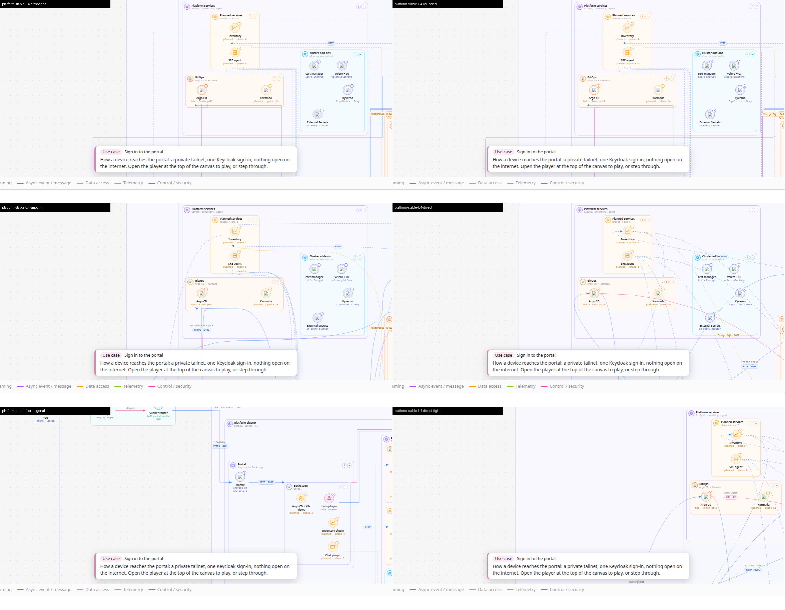
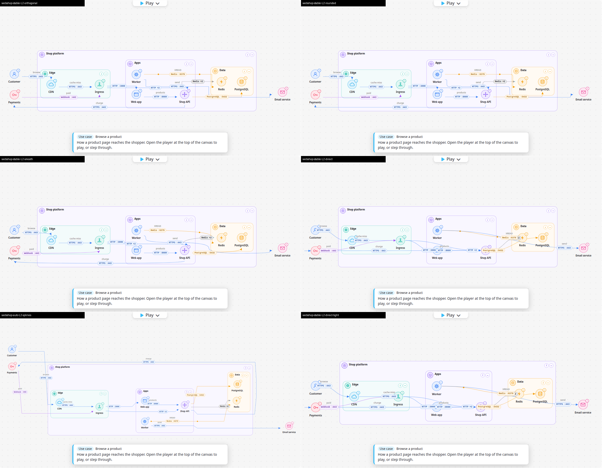
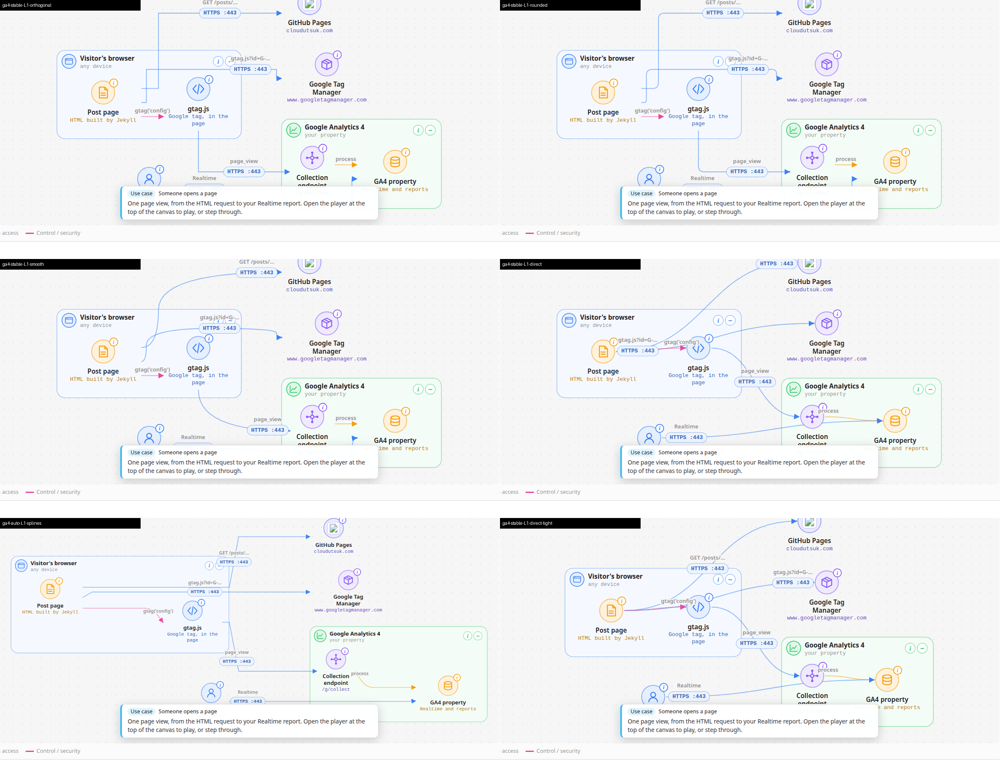

# Plan: curved arrows in interactive diagrams

**Status (2026-11-23):** Step 1 measured: curves don't save space; rounded corners are the safe win. Step 2 (the owner's choice) is next. No engine change yet.

## Why

The System Design Canvas scratch board draws each connection as a curve from the source's right handle to the
target's left handle (React Flow's `getBezierPath`, `components/problem/packet-edge.tsx`). Nodes can sit at any
height and the curve still reads well, so a few nodes fit in less room. The owner asked (2026-11-23) whether the
diagram skills (`interactive-diagrams` levels 1–3, and the blog's copy of the engine in
`sakharams.github.io/assets/js/diagram.js`) could do the same, and whether it would make better diagrams.

## How the engine draws arrows today

- **Placement:** ELK `layered` (left to right, or down), with `elk.edgeRouting: ORTHOGONAL` and fixed spacing:
  24 between nodes, 44 between layers, 14 between an arrow and a node, 9 between arrows (`engine/diagram.js`, the
  ELK options near the top).
- **Stable layout** (expand and collapse without moving the diagram): ELK only places; the engine's own A* router
  (`routeOrtho`) draws the arrows on a grid of channels between boxes, with a cost per bend and per shared segment,
  then spreads parallel segments into lanes.
- **Drawing:** every arrow is a polyline, `M x,y L x,y …` (`drawEdge`). Everything that sits on an arrow assumes
  straight segments: `measure`, `pointAt` and `nearestOnPath` (pill and label positions, hover), `placeLabels`
  (pills and labels kept off boxes and each other), the trail animation (`stroke-dasharray` from the measured
  length), and the guided use cases (level 3: the packet walks the arrow hop by hop). The moving dots use
  `animateMotion` on the path, which works with any path.

## Would curves save space?

Mostly not by themselves. Space is decided by where the nodes are placed, not by the shape of the arrows:

1. **Same placement, curved drawing** (rounding or smoothing the routed polyline): the same area. It looks softer
   and the bends read more easily, but nothing moves closer.
2. **ELK's spline routing** (`elk.edgeRouting: SPLINES`, layered supports it): ELK still places nodes in layers.
   Curves need no parallel lanes, so the space ELK keeps between layers for lanes can shrink a little; expect a
   modest gain (to be measured), mainly where many arrows run between two layers.
3. **Canvas style, port to port, ignoring obstacles:** this is where the canvas gains space. A curve between
   handles tolerates nodes that aren't aligned, so nodes can be packed by hand or by a compact placement (smaller
   layer spacing, or ELK `stress`/`force`). The cost: a curve may cross a box or another arrow, and with more than
   about 10–15 nodes the picture gets hard to follow. The canvas gets away with it because a person places every
   node and sees the result; this skill lays out up to 100+ components automatically.

Where curves do help readability: fan-out and fan-in (one load balancer to many services), arrows that would
otherwise need 3+ bends, and feedback arrows that go back against the flow (a curve going back is easier to tell
apart than another right angle).

Where they hurt: dense levels (crossing curves are harder to follow than crossing straight lines), and the flowchart
style (`swimlane-flowchart` keeps right angles on purpose).

## Options

| Option | What changes | Space | Effort | Risk |
|---|---|---|---|---|
| A. Rounded corners | The orthogonal path gets a small arc at each bend | Same | Small: the path string, plus measuring arcs | Low |
| B. Smoothed path | The routed points become a smooth curve (for example Catmull-Rom to cubic Béziers); routing unchanged | Same | Medium: measuring moves to the browser's `getTotalLength`/`getPointAtLength` | Low–medium |
| C. ELK splines | `elk.edgeRouting: SPLINES` for ELK layouts; the stable layout's router needs a curved mode too (route on the grid, then smooth) | Small gain | Medium–large | Medium: the stable layout uses its own router |
| D. Port to port | Each arrow is one Bézier between the two boxes' side handles, as in the canvas; optionally tighter spacing | Largest | Medium for drawing; large if placement also changes | High: arrows over boxes, label clashes |

All options would be a per-diagram setting (for example `edges: orthogonal | rounded | curved | direct`, default
`orthogonal`), and per group if needed, so no existing diagram changes.

## Steps

| Step | What | Done when |
|---|---|---|
| 1. Measure | Prototype A–D behind a URL switch in a scratch build; render three existing diagrams (the plugin's `examples/web-shop`, the platform diagram on the blog with 100+ components, one small diagram of 5–8 components) at each level | A table per diagram: drawn area, arrow crossings, arrows over boxes, pill or label clashes, layout time; screenshots side by side |
| 2. Decide | Pick the options worth keeping, the default, and whether placement changes too (only for option D) | The owner's choice, recorded as a decision in this plan |
| 3. Engine | Path drawing from a shape setting; measuring with `getPointAtLength` so pills, labels, trails and the use-case packet follow curves; the data option in `validate.py` and `reference/data-format.md` | The three diagrams build, validate and pass the browser check at every level, with each setting |
| 4. Skills and blog | The skills' docs say when to choose each style; the blog engine gets the same change (it is a copy) | Plugin release; blog diagrams unchanged unless a post opts in |

## Step 1 results (2026-11-23)

Prototype: branch `proto-curved-edges` (not for merging). One switch `?edges=` in the engine; each shape is flattened
into dense points, so pills, labels, trails and the use-case packet follow it. `direct` copies the canvas: leave
from the source's out side, enter the target's in side, loop round when the target is behind. `direct-tight` also
cuts ELK's spacing (between layers 44 → 28, arrow gaps 14/9 → 6/3). `splines` needs `layout: auto`.

Three diagrams, every level, browser 1500×950. Area is the deepest level (thousand px²); the other columns are
summed over all levels. "Over a box" counts arrows that run more than 6 px through a component they don't connect;
"clashes" counts pills and labels overlapping a component or each other.

| Diagram | Style | Area | Arrow length | Crossings | Over a box | Clashes |
|---|---|---|---|---|---|---|
| GA4 page view (7 components) | orthogonal | 343 | 2,520 | 1 | 0 | 3/18 |
| | rounded | 343 | 2,466 | 1 | 0 | 3/18 |
| | smooth | 343 | 2,242 | 1 | 0 | 1/18 |
| | direct | 343 | 2,756 | 2 | 3 | 11/18 |
| | direct-tight | 328 | 2,553 | 2 | 3 | 9/18 |
| | auto: orthogonal / splines | 542 / 542 | 3,324 / 3,143 | 0 / 0 | 0 / 0 | 0 / 6 of 18 |
| Web shop (10) | orthogonal | 472 | 6,577 | 1 | 0 | 0/36 |
| | rounded | 472 | 6,486 | 1 | 0 | 0/36 |
| | smooth | 472 | 6,218 | 1 | 0 | 1/36 |
| | direct | 478 | 6,832 | 7 | 7 | 26/36 |
| | direct-tight | 457 | 6,312 | 7 | 7 | 28/36 |
| | auto: orthogonal / splines | 1,053 / 1,053 | 10,325 / 9,978 | 3 / 3 | 0 / 0 | 0 / 10 of 36 |
| Cloudutsuk Platform (74 at level 4) | orthogonal | 15,035 | 134,501 | 195 | 0 | 5/193 |
| | rounded | 15,035 | 133,254 | 197 | 0 | 5/193 |
| | smooth | 15,035 | 118,747 | 194 | 16 | 18/193 |
| | direct | 15,035 | 120,749 | 277 | 66 | 59/193 |
| | direct-tight | 14,863 | 113,317 | 236 | 69 | 67/193 |
| | auto: orthogonal | 34,308 | 222,031 | 176 | 0 | 0/193 |
| | auto: splines | — | — | — | — | — |

Findings:

1. **No style saves meaningful space.** The area is set by placement. Even with tighter spacing, canvas-style
   arrows shrink the deepest level by 1–4%. The stable layout is already less than half the area of `layout: auto`
   on the platform diagram, and that gain comes from placement, not arrows.
2. **Rounded corners change nothing measurable:** same area, crossings, clashes, about 1% shorter arrows. Only the
   look changes, so this is the safe default.
3. **Smooth curves read best on small diagrams** (GA4 and web shop: fewer clashes, 5–11% less ink). On the platform
   diagram they cut corners through components (16 arrows over a box, against 0) and clashes go from 5 to 18.
4. **Canvas-style (direct) arrows are worse everywhere:** 3–9× the clashes, arrows over components on every
   diagram, more crossings. A person placing every node can avoid that; an automatic layout can't.
5. **ELK splines are out:** elkjs 0.12.0 crashes on the platform diagram (`Cannot read properties of null`, inside
   ELK, also after the retry without wrapping). On the small ones the arrows come back with diagonal segments rather than
   curves, and clashes rise (0 → 6 and 0 → 10).

Screenshots side by side (deepest level, six styles each):

Every level and style (75 screenshots), the raw numbers (`results.json`) and the measuring script
(`measure.cjs`, Playwright) are on the prototype branch `proto-curved-edges`, in `docs/plans/diagram-curved-edges-measure/`.

**Recommendation for step 2:** rounded corners as a choice for every diagram (`edges: rounded`), possibly the new
default since it changes no numbers; smooth curves as an opt-in for small diagrams (up to about 15 components), with
a fix to stop corner-cutting (limit the curve to the free channel, which is what rounded with a large radius does).
Drop ELK splines and canvas-style arrows.

## Recommendation before measuring

Expect A or B to be the cheap win (softer arrows, same layout, low risk) and D to be the only real space saver,
worth it for small diagrams (up to about 15 components) and not for the large platform diagram. Step 1 is there
to check that with numbers rather than taste.

## Progress

| Step | Status | PRs | Left |
|---|---|---|---|
| 1. Measure | Done 2026-11-23 | #20 | — |
| 2. Decide | Next | — | Owner's choice (see the recommendation) |
| 3. Engine | Planned | — | After step 2 |
| 4. Skills and blog | Planned | — | After step 3 |

Waiting on the owner: step 2, which styles to keep and whether rounded becomes the default.
